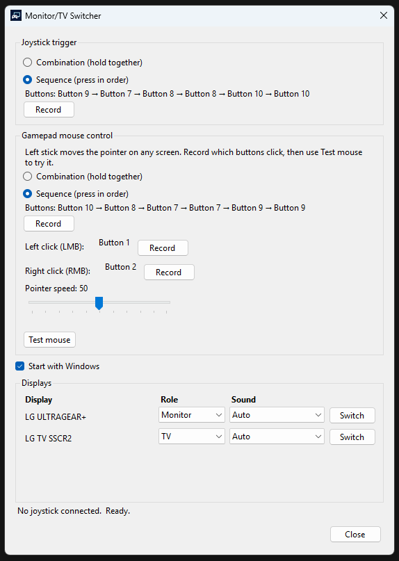
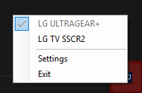

# Monitor/TV Switcher

A Windows tray app that switches your PC between a **monitor** and a **TV** from a joystick or gamepad. It also applies the right resolution, turns HDR on when the TV is selected, and moves Windows sound to the matching playback device.

**Requirements:** Windows 10 or 11, 64-bit. No .NET install is required.

## Screenshots

<p>
  
</p>

<p>
  
</p>

## Download 1.0

- **[Installer (recommended)](https://github.com/patrickn2/MonitorTVSwitcher/releases/download/v1.0/MonitorTVSwitcher-Setup-1.0.exe)** — `MonitorTVSwitcher-Setup-1.0.exe`
- **[Portable zip](https://github.com/patrickn2/MonitorTVSwitcher/releases/download/v1.0/MonitorTVSwitcher-1.0-win-x64.zip)** — extract and run `MonitorTVSwitcher.exe`
- All files: **[Releases](https://github.com/patrickn2/MonitorTVSwitcher/releases/tag/v1.0)**

Setup does not need administrator rights. Optional desktop shortcut and “Start with Windows” are offered during install.

Windows SmartScreen may warn on the first run because this build is not Authenticode-signed. That is expected for a new unsigned app. Choose **More info** → **Run anyway** if you trust this project.

## Antivirus

Microsoft Defender scanned the 1.0 binaries on 26 August 2026 and **found no threats**.

| File | SHA256 | Defender |
| --- | --- | --- |
| `MonitorTVSwitcher-Setup-1.0.exe` | `25EA2D919A829D0018763034BFC9A3E3CE8F9DB960EA6BB4325F79F64B294542` | No threats found |
| `MonitorTVSwitcher-1.0-win-x64.zip` | `35BE7D21A68858ADD0BF9E9F9A5F6EB7364DCD149BB0A5DE405200733BCAF2C7` | No threats found |

Full scan log: [antivirus-report.md](antivirus-report.md)

Re-check the installer yourself on [VirusTotal](https://www.virustotal.com/gui/file/25EA2D919A829D0018763034BFC9A3E3CE8F9DB960EA6BB4325F79F64B294542).

## How it works

The app stays in the notification area.

- **Joystick trigger** — record a button combination (hold together) or a sequence (press in order). When that input is seen, the app switches to the other display.
- **Tray menu** — pick a display by name.
- **Settings** — mark each screen as Auto, TV, or Monitor, and optionally pin a sound device to that screen.

### Gamepad mouse control

A second recorded joystick shortcut (combination or sequence, same as the display switch) toggles mouse mode on any screen:

- **Left stick** moves the pointer.
- Record which buttons are **left click** and **right click** (hold to drag).
- **Pointer speed** is adjustable in Settings.
- **Test mouse** in Settings turns the pointer on immediately so you can try stick, clicks, and speed.
- The same shortcut turns it off.
- While mouse mode is on, the click buttons are not used for the display-switch shortcut, and Settings Switch buttons stay disabled so a mis-click cannot change display.

Record the mouse shortcut and click buttons in **Settings → Gamepad mouse control**.

When you switch:

1. The chosen display becomes the only active screen.
2. A suitable resolution is applied.
3. HDR is enabled on the TV when the display supports it.
4. Default playback follows the TV (HDMI / ARC / the device you picked) and returns to the last monitor speakers when you switch back.

## Build from source

```powershell
.\build-installer.ps1
```

That publishes a self-contained `win-x64` build and compiles `dist\MonitorTVSwitcher-Setup-1.0.exe` with Inno Setup (downloaded automatically if needed).

Open `MonitorTVSwitcher.slnx` in Visual Studio or run `dotnet build MonitorTVSwitcher.slnx -c Release`.
